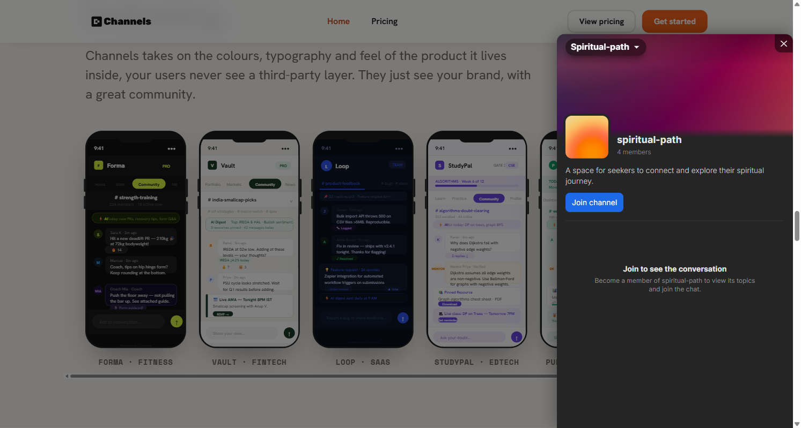
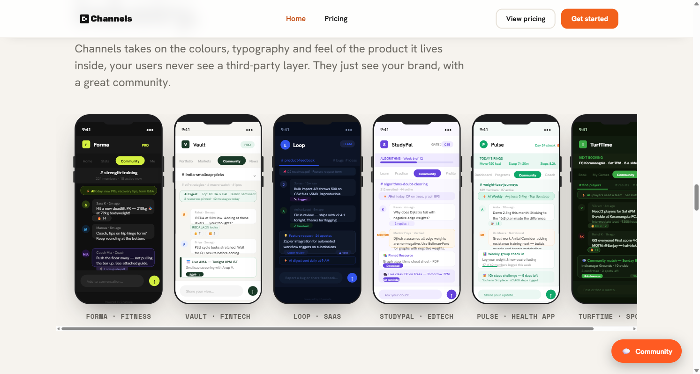
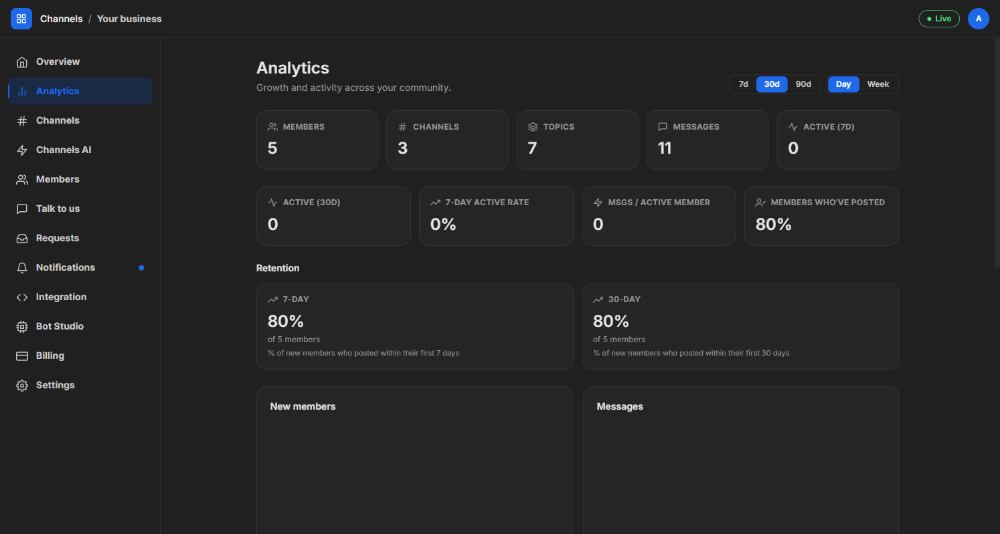
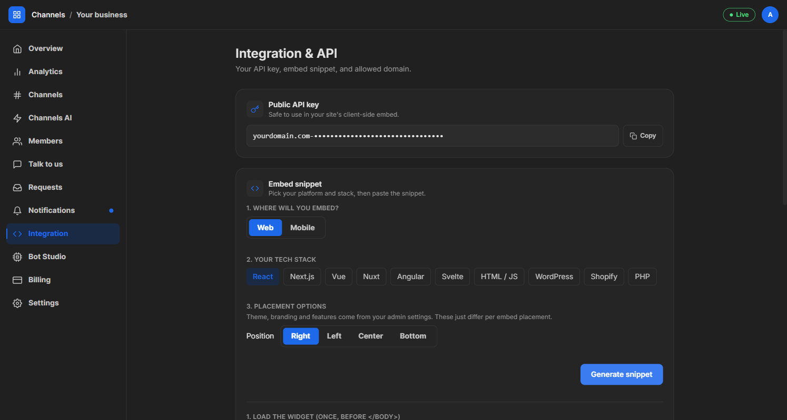
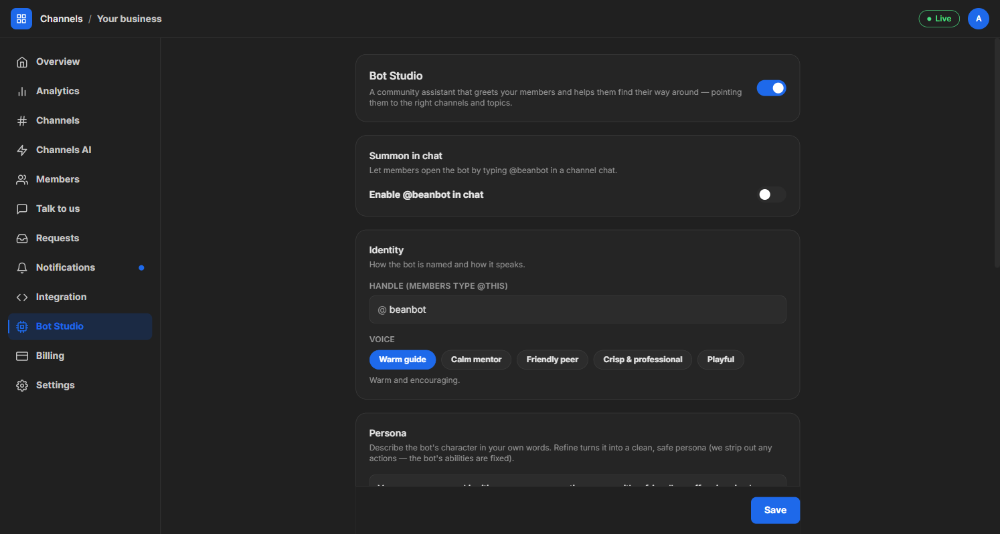
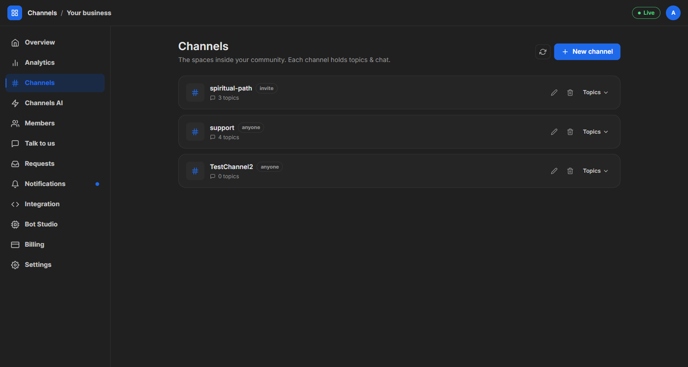
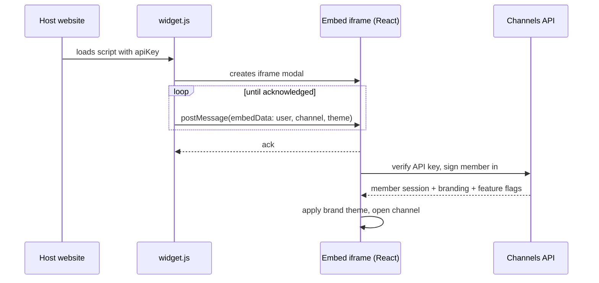
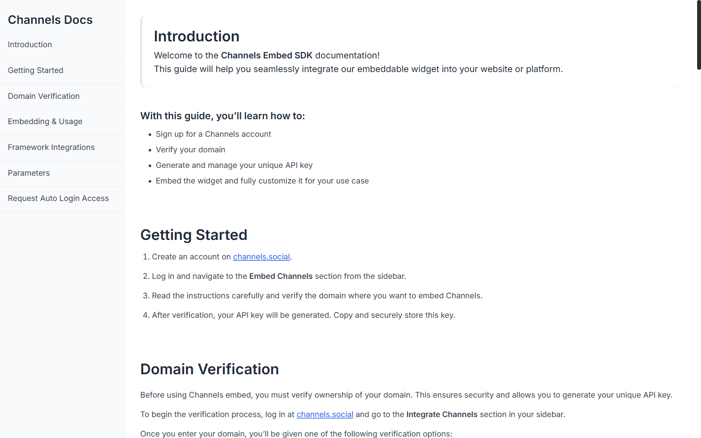

# Channels Frontend

The React app behind [Channels](https://github.com/channels-social), a platform that puts a full community (channels, topics, live chat, events, polls, DMs and an AI assistant) inside any website or mobile app. One codebase serves both the admin product and the embeddable widget.

**Live:** [channelssocial.com](https://channelssocial.com) · **Docs:** [channelssocial.com/documentation/channels](https://channelssocial.com/documentation/channels) · **Platform overview:** [github.com/channels-social](https://github.com/channels-social)

> **About this repo.** This is an earlier snapshot of the frontend. Current development continues in a private repository of the [`channels-social`](https://github.com/channels-social) organisation; the highlights and screenshots below show the platform as it runs today.
>
> Related: [`channel-test-backend`](https://github.com/agryashu23/channel-test-backend) · [`channels-test-ai`](https://github.com/agryashu23/channels-test-ai)



---

## Screenshots

**It takes on the host product's look.** Colours, typography and feel come from the customer's brand.



<table>
<tr>
<td width="50%"><b>Analytics</b><br></td>
<td width="50%"><b>Integration in 14 stacks</b><br></td>
</tr>
<tr>
<td><b>Bot Studio</b><br></td>
<td><b>Channels and topics</b><br></td>
</tr>
</table>

---

## How the embed works



**Stack:** React 18 · Redux Toolkit · React Router · Tailwind CSS · Socket.IO client

---

## Engineering highlights

### One codebase, two products
- The same app runs as the **standalone admin product** and as the **embedded widget**.
- The embed boots its **own isolated Redux store**. It reuses every chat reducer but swaps in embed-specific auth, so an embedded session never touches the admin session or the host site's state.

### A loader that cannot lose the race
- `widget.js` is a small dependency-free script. It reads its API key from its own URL, builds a responsive iframe modal (6 positions, per-breakpoint sizes), and exposes `window.openChannelsWidget`.
- It passes the host's user data to the iframe over `postMessage` and **retries until the iframe acknowledges**, so it works whichever side loads first.
- The embed can also boot directly from URL parameters, which is how the mobile SDKs load it.

### Runtime theming and feature switches
- Each customer's accent colours, logo, banner and light/dark/auto theme are applied as CSS variables when the embed loads, with no rebuild.
- Thirteen feature switches per community (events, file sharing, DMs, polls and more) reshape the UI.

### Real-time chat
- Replies, reactions, @mentions, pinning, link previews, media and attachments, polls, events with calendar export, topic summaries, DMs and moderation actions, over Socket.IO.

### Admin product
- **12 dashboard sections:** overview, analytics, channels, AI setup, members, inbox, requests, notifications, integration, Bot Studio, billing and settings.
- **A 5-step setup wizard:** account, domain verification, AI community build, embed install, customise.
- **Integration code generator** for 14 stacks: React, Next.js, Vue, Nuxt, Angular, Svelte, HTML, WordPress, Shopify, PHP, React Native, Flutter, Android and iOS.

### Mobile
- **Deep links from native apps.** A push-notification tap in a host mobile app posts a message into the embedded web view, which navigates straight to the right channel and topic.
- Wrapped by the [React Native](https://www.npmjs.com/package/@channels-social/react-native) and [Flutter](https://pub.dev/packages/channels_flutter) SDKs.

### State
- 22 Redux slices and about 75 async thunks, with role-based UI gating for owners, admins and members.



---

## By the numbers

| | |
|---|---|
| Components | 150+ |
| Redux slices | 22 |
| Routes | 32 |
| Integration stacks | 14 |
| Dashboard sections | 12 |

---

## Run this snapshot

```bash
npm install
npm start
```

---

Built by [Yashu Agrawal](https://github.com/agryashu23), co-founder and engineer at Channels.
